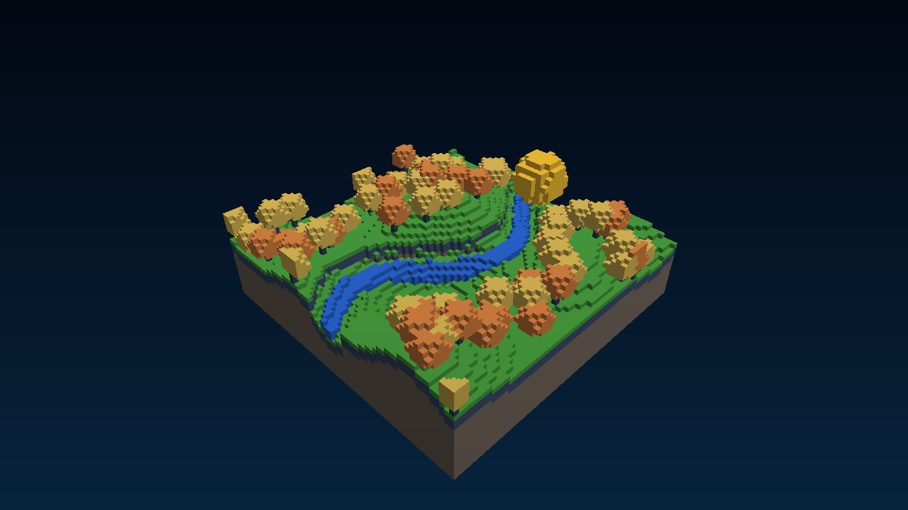
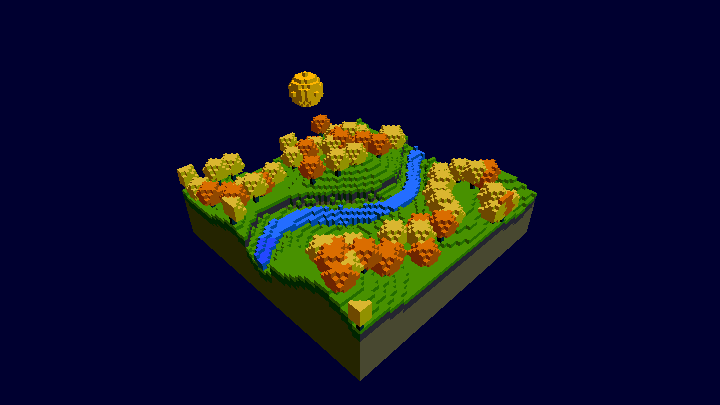

# GPU Voxels

A real-time voxel renderer written in C++ and GLSL. The scene lives in a 64×64×64 OpenGL 3D texture, and the fragment shader traverses that volume with a DDA ray caster.

## Scene preview

The sphere flies above the treetops while the GIF camera gently sweeps from side to side:

The interactive application is a Windows desktop project.

## Build the application

Open `GpuVoxels.sln` in Visual Studio on Windows. The project uses FreeGLUT, GLM and glload; make those dependencies available to the compiler and linker before building.
